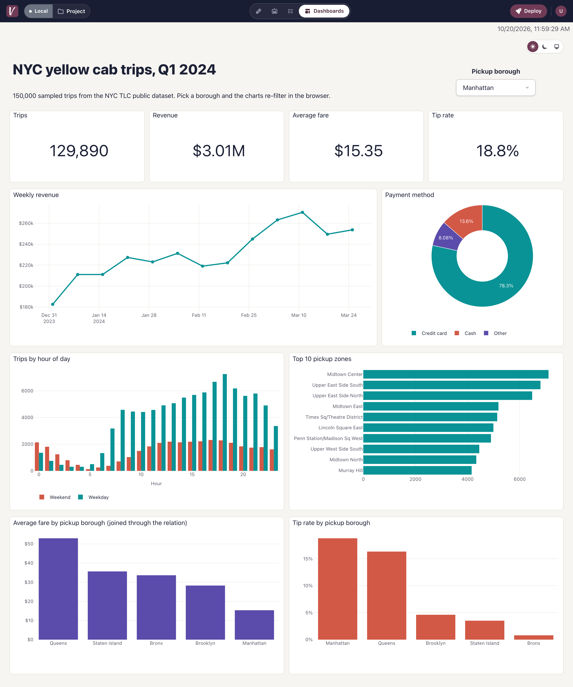
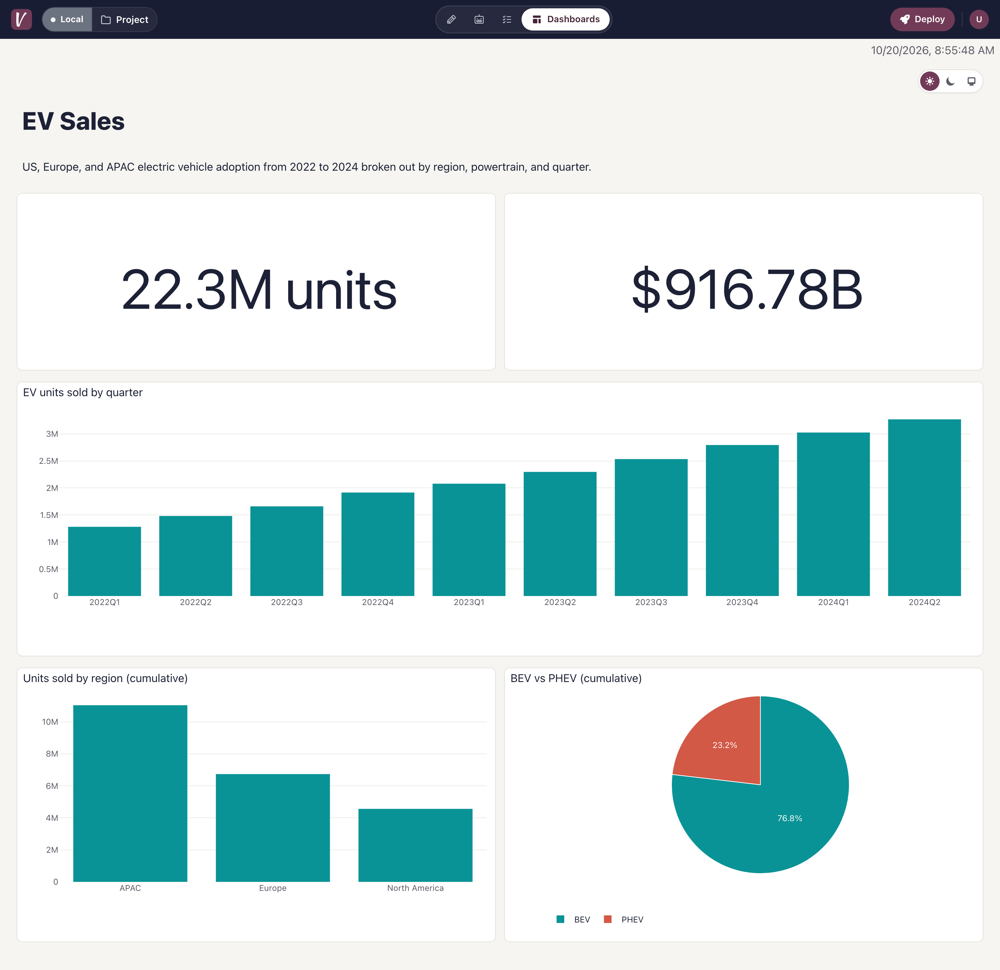
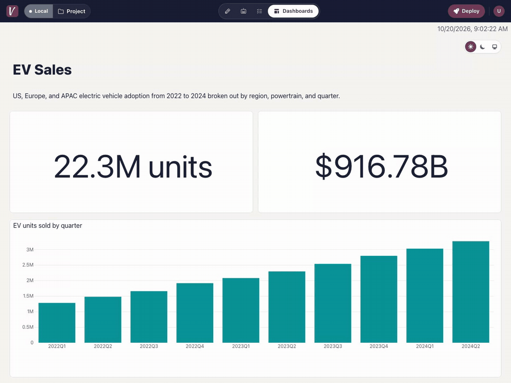
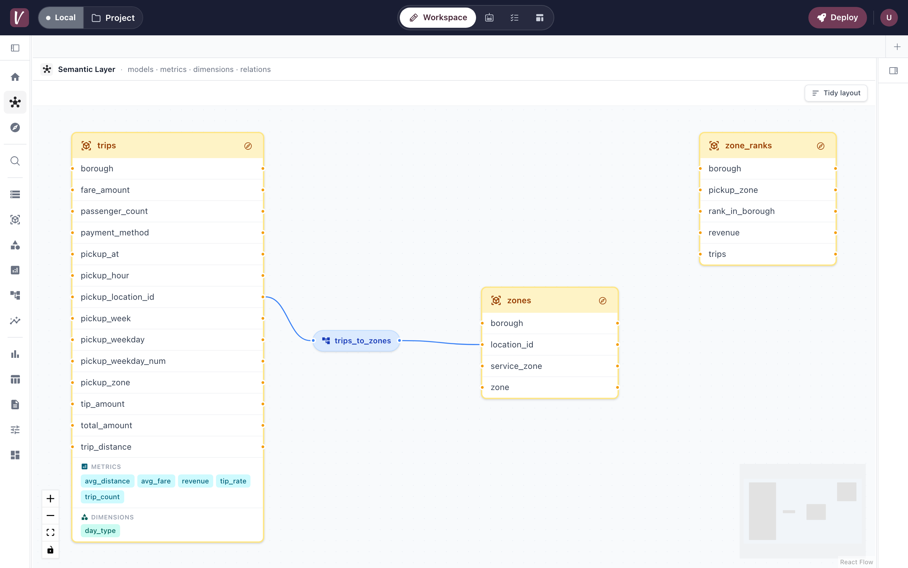
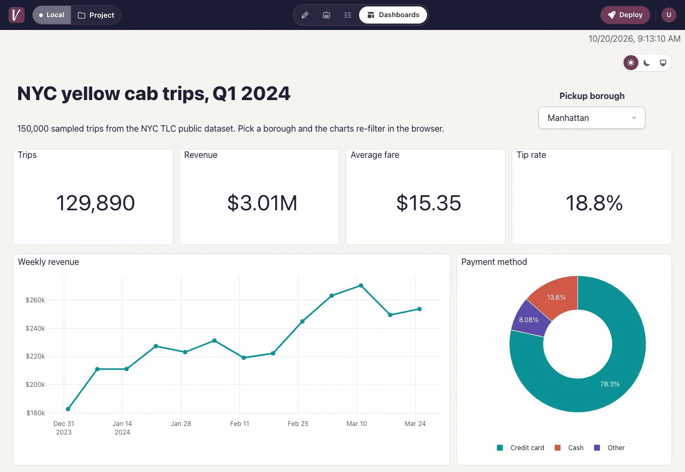
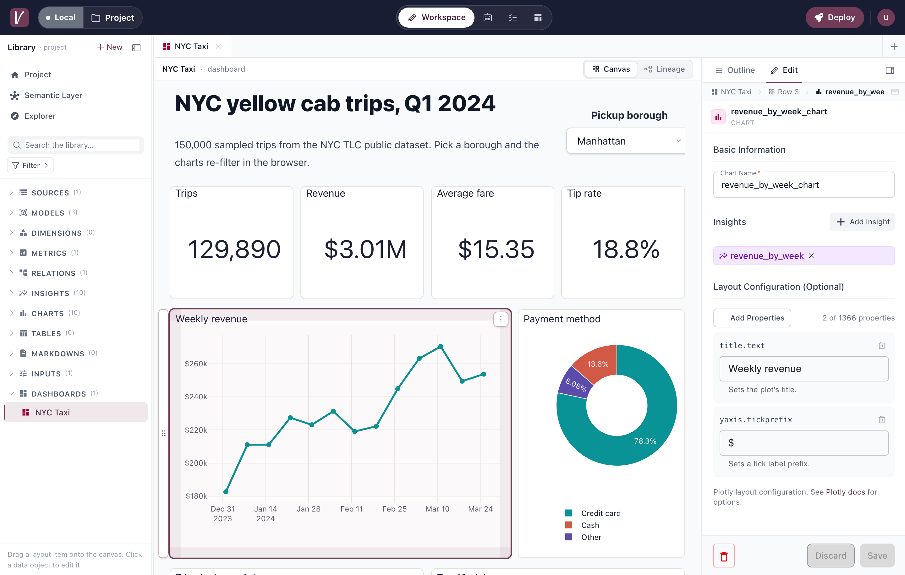
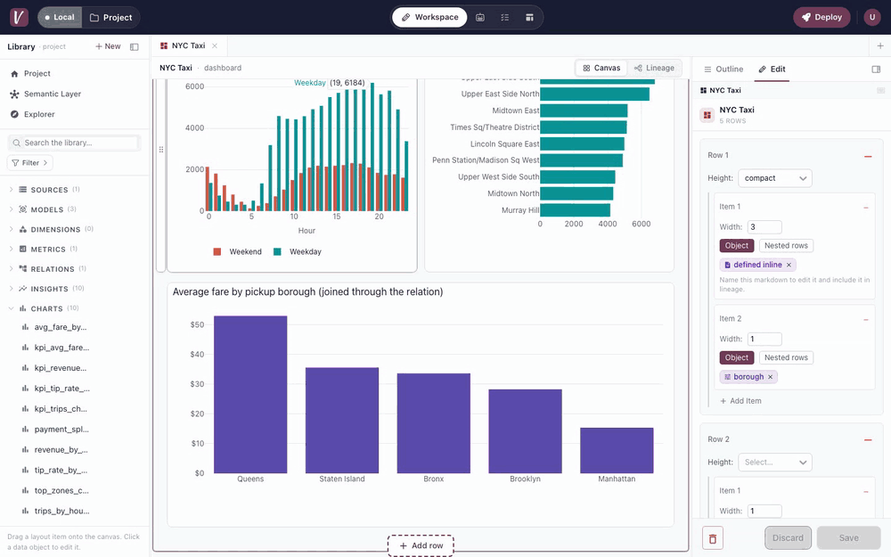
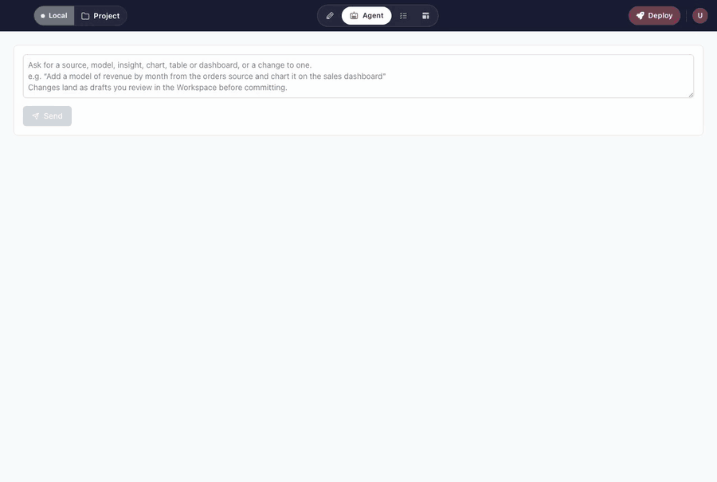
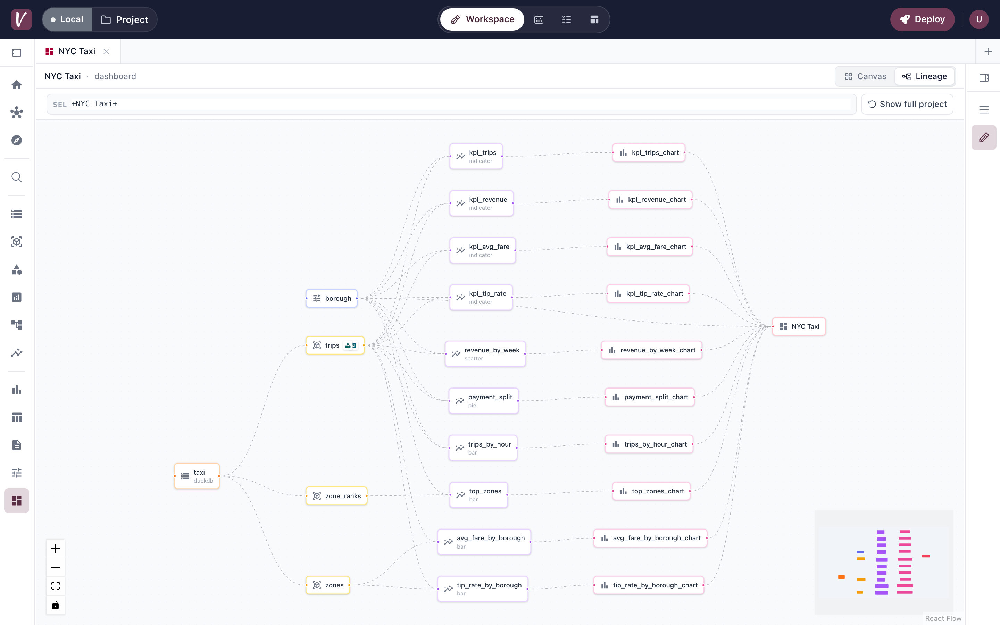
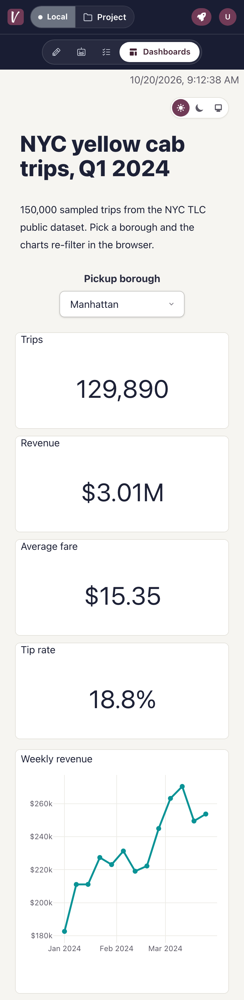

<p align="center">
  
</p>

<h1 align="center">BI as code, built for people and agents</h1>

<p align="center">
  Define sources, a semantic layer and dashboards in YAML. Develop locally with instant reload, review changes in pull requests, and let an AI agent draft the next chart against the same definitions.
</p>

<p align="center">
  <a href="https://docs.visivo.io">Docs</a> ·
  <a href="https://docs.visivo.io/#quick-start">Quick start</a> ·
  <a href="https://docs.visivo.io/ai-usage/">Build with AI</a> ·
  <a href="https://visivo.io">Website</a> ·
  <a href="https://app.visivo.io">Visivo Cloud</a> ·
  <a href="https://github.com/visivo-io/visivo/discussions">Discussions</a>
</p>

<p align="center">
  <a href="https://pypi.org/project/visivo/"></a>
  <a href="https://pypi.org/project/visivo/"></a>
  <a href="license.txt"></a>
  <a href="https://github.com/visivo-io/visivo/stargazers"></a>
</p>

<p align="center">
  
</p>
<p align="center">
  <sub>This dashboard is <a href="test-projects/readme-taxi/project.visivo.yml">one YAML file</a>: a DuckDB source, three models with metrics and dimensions, a relation, one input, ten insights, ten charts, one dashboard. The borough dropdown re-filters the charts in the browser.</sub>
</p>

## A dashboard in 60 seconds

```bash
pip install visivo                 # Python 3.12+
visivo init --example ev-sales     # copies a sample project, starts the dev server, opens the browser
```

`init --example` writes a `project.visivo.yml`, a small DuckDB file and the CSV it came from, then runs `visivo serve` on http://localhost:8000. The other bundled examples are `github-releases` and `college-football`.

Prefer a single binary with no Python? `curl -fsSL https://visivo.sh | bash` installs one to `~/.visivo/bin` (macOS 15+, Linux x86_64, Windows through WSL). To start from your own data, run `visivo init` and the in-browser wizard walks you through adding a source.

<p align="center">
  
</p>

Edit the YAML and save. The dev server recompiles and re-runs what changed, and layout and style edits redraw in the open tab without a reload. No build step.

<p align="center">
  
</p>

## What a project looks like

Every Visivo project is the same chain of objects: a **source** you query, **models** that name a SQL query, a **semantic layer** of metrics, dimensions and relations on top of those models, **insights** that pick fields and aggregates to plot, **charts** that give insights a Plotly layout, and **dashboards** that lay charts, tables, markdown and inputs out in rows.

```yaml
sources:
  - name: taxi
    type: duckdb
    database: taxi.duckdb

models:
  - name: trips
    source: ${ref(taxi)}
    sql: SELECT * FROM yellow_trips
    metrics:
      - name: revenue
        expression: SUM(total_amount)
      - name: tip_rate
        expression: SUM(tip_amount) / SUM(fare_amount)
    dimensions:
      - name: pickup_week
        expression: date_trunc('week', tpep_pickup_datetime)
      - name: payment_method
        expression: CASE payment_type WHEN 1 THEN 'Credit card' WHEN 2 THEN 'Cash' ELSE 'Other' END

inputs:
  - name: payment
    type: single-select
    options: ["Credit card", "Cash"]

insights:
  - name: revenue_by_week
    props:
      type: scatter
      mode: lines
      x: ?{ ${ref(trips).pickup_week} }
      y: ?{ ${ref(trips).revenue} }
    interactions:
      - filter: ?{ ${ref(trips).payment_method} = '${ref(payment).value}' }

charts:
  - name: revenue_by_week_chart
    insights:
      - ${ref(revenue_by_week)}
    layout:
      title:
        text: Weekly revenue

dashboards:
  - name: Revenue
    rows:
      - height: compact
        items:
          - input: ${ref(payment)}
      - height: medium
        items:
          - chart: ${ref(revenue_by_week_chart)}
```

`?{ }` wraps a SQL expression. `${ref(object).field}` points at a model column, a metric, a dimension or an input value, and Visivo resolves the joins and the `GROUP BY` for you. Define `revenue` once and every insight that references it computes it the same way.

## Why Visivo

**It is code, so it gets the software workflow.** Projects are YAML in git. A dashboard change is a branch, a diff and a pull request. In CI, `visivo run` executes the queries and `visivo deploy -s <stage>` publishes a preview stage named after the branch to [Visivo Cloud](https://app.visivo.io), so a reviewer opens the rendered dashboard next to the diff. `visivo archive -s <stage>` cleans it up when the PR closes. The [CI/CD guide](https://docs.visivo.io/topics/ci-cd/) has a complete GitHub Actions workflow.

**A semantic layer that people and agents share.** Metrics, dimensions and relations live in the project, not in each chart. Model columns are dimensions by default; relations declare how models join so an insight can pull fields from two models and get the right SQL. The same definitions are what the built-in agent and external MCP clients read before they write anything.

<p align="center">
  
</p>

**Interactive without round trips.** Inputs (dropdowns, radios, tabs, sliders, range sliders, date ranges, chips, checkboxes) feed `filter`, `split` and `sort` interactions. Those run in the browser on the insight's pre-computed data through DuckDB-WASM, so switching a filter re-aggregates instantly and never touches your warehouse.

<p align="center">
  
</p>

**Local first.** `visivo serve` runs the project, watches your files and rebuilds on every save. The same server hosts a workspace where you can explore a source, draft insights against live data, lay out a dashboard on a canvas, edit the theme, and commit the result back to your YAML.

<p align="center">
  
</p>

Layout is drag and drop: pull a chart from the Library onto a row, grab a selected card by its frame to reorder it, then save the result to the YAML.

<p align="center">
  
</p>

**Push, not pull.** `visivo run` executes the queries wherever you run it, on your laptop or in CI, and writes the results next to the project. `visivo deploy` ships those results, so the hosted viewer never needs a connection to your warehouse.

## Build with an agent

Visivo ships an agent and an MCP server. Both use the same tools and the same packaged skills, and neither can write your YAML files or commit: every write lands as a draft that you review in the workspace, then commit or discard.

**Your agent, over MCP.** `visivo serve` exposes `http://localhost:8000/api/mcp/` (Streamable HTTP, no auth on localhost). Point Claude Code, Cursor, Gemini CLI or any MCP client at it:

```bash
claude mcp add --transport http visivo http://localhost:8000/api/mcp/
```

The server offers `list_*`, `get_*`, `validate_*` and `write_*` for every project object type (sources, models, metrics, dimensions, relations, insights, charts, tables, markdown, inputs, dashboards), read-only data tools (`describe_source`, `query_source`, `profile_model`, `profile_columns`, `preview_insight`), charting advisors (`recommend_charts`, `recommend_inputs`, `check_input_wiring`, `recommend_layout`, `score_candidates`) and `read_skill` for the packaged skills such as `choose-a-chart`, `design-a-dashboard` and `make-it-interactive`. The skills encode measured chart rules for every Plotly trace type, so an agent gets the chart family, the input wiring and the layout right instead of guessing.

<p align="center">
  
</p>

**The built-in agent.** The Agent tab in `visivo serve` runs the same loop with your own Anthropic, OpenAI or Google key, or with inference from your Visivo Cloud account. `visivo init` also writes an `AGENTS.md` where you keep naming rules and business definitions for either path. Read [Build with AI](https://docs.visivo.io/ai-usage/) for the four ways to run it and the draft boundary.

## Everything else in the box

- **Sources:** PostgreSQL, MySQL, SQLite, Snowflake, BigQuery, Redshift, ClickHouse, DuckDB, CSV and Excel files. One dashboard can read from several.
- **48 chart types**, every Plotly trace: bar, line, scatter, pie, indicator (KPI), heatmap, histogram, box, candlestick, sankey, funnel, treemap, choropleth and mapbox maps, 3D, and more. Plus tables with pivots, cell formatting and paging, and markdown.
- **dbt™ integration:** a `dbt:` block turns your dbt models and targets into Visivo models and sources (`visivo dbt` refreshes them).
- **Themes:** built-in light and dark modes with a viewer toggle, a `theme:` block for colorway, fonts and surfaces, and a `plotly_layout` escape hatch.
- **Query-backed inputs:** `options: ?{ SELECT DISTINCT region FROM ${ref(sales)} }` fills a dropdown from your data at build time.
- **Static distribution:** `visivo dist` packages the viewer and the last run's data into a folder you can host on S3, GitHub Pages or any static host.
- **Visivo Cloud:** `visivo deploy` pushes the project and its data to [app.visivo.io](https://app.visivo.io) under a named stage, with sharing, teams and roles.
- **Lineage:** every dashboard has a Lineage view that draws its DAG from sources to the dashboard, so you can see what a change touches.

<p align="center">
  
</p>

Rows stack on phones, so the same dashboard reads on a 390 px screen.

<p align="center">
  
</p>

## How it compares

|  | GUI BI tools (Tableau, Looker, Power BI, Metabase, ...) | Visivo |
|---|---|---|
| Definition | Click-built in a GUI; hard or impossible to version | YAML in git |
| Review | No diff, no pull request | Branch, diff, PR, preview stage |
| Environments | Usually one shared instance | Named stages for dev, CI and production |
| Data access | You hand the vendor credentials to pull your data | You run the queries and push the results |
| Agents | Vendor chat features over vendor-held metadata | A local MCP server and a built-in agent over the same project files, drafts you review |
| Where it lives | Outside your transformation stack | Next to your dbt, Django or Rails project |

Visivo is not a warehouse, a transformation tool or a notebook. It reads the tables you already have and turns them into reviewable dashboards.

## Learn more

- [Quick start](https://docs.visivo.io/) and [installation](https://docs.visivo.io/installation/)
- [Concepts](https://docs.visivo.io/concepts/): source, model, semantic layer, insight, input, dashboard
- [Semantic layer](https://docs.visivo.io/topics/semantic-layer/), [inputs](https://docs.visivo.io/topics/inputs/) and [interactivity](https://docs.visivo.io/topics/interactivity/)
- [Build with AI](https://docs.visivo.io/ai-usage/) and [connect your agent with MCP](https://docs.visivo.io/ai/mcp/)
- [CI/CD for BI](https://docs.visivo.io/topics/ci-cd/), [deployment](https://docs.visivo.io/topics/deployments/) and [static distribution](https://docs.visivo.io/topics/static-distribution/)
- [CLI reference](https://docs.visivo.io/reference/cli/) and [configuration reference](https://docs.visivo.io/reference/configuration/Insight/)

## Community and contributing

- [GitHub Discussions](https://github.com/visivo-io/visivo/discussions) for questions and show-and-tell
- [Issues](https://github.com/visivo-io/visivo/issues) for bugs and feature requests
- [CONTRIBUTING.md](CONTRIBUTING.md) for the development setup: Python CLI in `visivo/`, React viewer in `viewer/`, tests in `tests/`

Visivo collects anonymous usage telemetry (command names, no queries, no file contents, no personal data). Run `visivo telemetry off` to opt out on a machine, or set `VISIVO_TELEMETRY_DISABLED=true`. Details are in the [telemetry docs](https://docs.visivo.io/topics/telemetry/).

## License

Visivo is released under the [GNU General Public License v3.0](license.txt).
